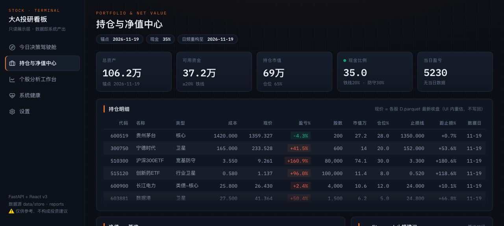

# astock-terminal

本地优先的 A 股投研终端。FastAPI + React + ECharts，数据全部留在本机磁盘。

[](https://github.com/Zdj-2025/astock-terminal/actions/workflows/ci.yml)
[](LICENSE)

收盘后两个 cron 脚本跑扫描，看板展示四路信号（止损 / 金叉 / 底背离 / 超跌反转）、
持仓净值、个股分析（K线、双参数 MACD、缠论、波浪）。持仓和资金记在本地 Excel，
没有账号系统，不上传任何数据。AI 解盘可选，走 OpenAI 兼容接口。

| | |
|---|---|
|  |  |
|  |  |

## 快速开始（演示数据）

```bash
git clone https://github.com/Zdj-2025/astock-terminal && cd astock-terminal
pip install -r requirements.txt
cd web/frontend && npm install && npm run build && cd ../..
make demo
# 打开 http://localhost:8601
```

`make demo` 用脚本生成的合成行情装一套演示数据，先用 30 秒看界面是否合用，
再决定要不要接真实数据。

## 接入真实数据

```bash
make init        # 生成 .env 和持仓模板（向导里有 tushare 注册链接）
# 编辑 config/portfolio.xlsx（持仓）、config/capital.xlsx（资金）
PYTHONPATH=. python scripts/data/update_all_kline.py     # 首次全市场日线
PYTHONPATH=. python scripts/screener/daily_scan_all.py   # 首次收盘扫描
make serve
```

之后 crontab 挂两个任务：16:10 `update_all_kline`，16:15 `daily_scan_all`。
第二天起看板就是当日数据。细节见 [docs/quickstart.md](docs/quickstart.md)。

## 数据源怎么配

不配也能用：已有 parquet 数据或 demo 模式下，四页看板完整可用。需要下载日线、
跑缠论和综合评分时才需要 Tushare token。两种配法：

1. **界面**：看板「设置」页粘贴 token 保存。保存到 `config/settings.local.json`，
   立即生效，crontab 里的命令行脚本读同一份配置。
2. **文件**：复制 `.env.example` 为 `.env`，填 `TUSHARE_TOKEN=...`。适合服务器、
   Docker 场景。两边都配时以 `.env` 为准。

费用：[tushare.pro](https://tushare.pro/user/register) 注册免费送 120 积分，够日线和大部分基础接口；
充值提高积分档位后**同一个 token 自动解锁**更多接口和更高频次，不需要改任何配置。
akshare 是另一路免费源（实时、分钟线），`pip install -r requirements-full.txt` 即可，
稳定性一般。各档位能点亮哪些功能见 [docs/data-sources.md](docs/data-sources.md)。

## 大模型怎么配

AI 解盘走 OpenAI 兼容协议，GLM / DeepSeek / OpenAI / 本地 Ollama 都行，不配则该功能隐藏，
其余不受影响。同样是两种配法（「设置」页可以点常用服务商一键填入 Base URL）：

1. **界面**：看板「设置」页填 Base URL、Model、API Key，点「测试连接」验证后保存。
2. **文件**：`.env` 里填 `LLM_API_KEY` / `LLM_BASE_URL` / `LLM_MODEL`。

本地 Ollama 填 `http://localhost:11434/v1`，Key 随便填一个非空字符串即可，解盘数据不出本机。

## 架构

```
web/backend    FastAPI：页面级聚合端点 + 设置 + AI 解盘 + 晨报/晚报（对数据只读）
web/frontend   React 18 + Vite + ECharts：交易终端风（等宽数字 / CVD 校验色板）
scripts/       数据层 · 分析层 · 筛选层 · 回测 · 130+ 研究脚本
templates/     持仓/资金模板     demo/  合成演示数据     deploy/  Docker
```

看板对数据只读：不触发扫描、不写交易数据。扫描与更新是 `scripts/` 下的独立命令，
crontab 调度。目录重定向等配置见 [docs/configuration.md](docs/configuration.md)，
常见问题见 [docs/faq.md](docs/faq.md)。

## 免责声明

本项目输出（含 AI 解读）是程序计算与信息整理，不构成投资建议，交易决策与盈亏
自行承担。详见 [DISCLAIMER.md](DISCLAIMER.md)。

## 许可

AGPL-3.0。云服务使用本项目需开放源码，或联系商业授权（[Issues](https://github.com/Zdj-2025/astock-terminal/issues)）。

---

A self-hosted A-share research terminal (FastAPI + React + ECharts): daily scanners
(stop-loss / golden cross / divergence / oversold reversal), portfolio and equity
tracking from local spreadsheets, a per-stock workbench (K-line, dual-parameter MACD,
Chan theory, Elliott waves), and an optional AI digest via any OpenAI-compatible API.
Data stays on your disk. AGPL-3.0; commercial licensing available.
