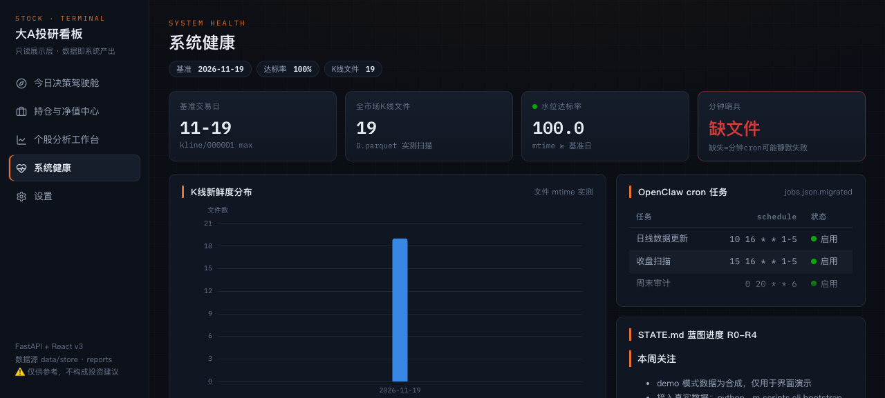

<div align="center">

# 📈 astock-terminal

**本地优先的 A 股投研终端 —— 数据自持 · 策略可改 · AI 可选**

[](https://github.com/Zdj-2025/astock-terminal/actions/workflows/ci.yml)
[](LICENSE)
[](pyproject.toml)
[](docs/faq.md)

FastAPI + React 18 + ECharts 四页决策看板 · 收盘扫描信号体系 · OpenAI 兼容 AI 解盘<br/>
你的行情、持仓、净值 —— **全部留在你自己的磁盘上，一个字节都不上传**。

</div>

---

## 为什么做这个？

市面上的看板产品要你把**持仓和资金**交给云端；开源量化框架又大多止步于回测，
离「每天收盘后 5 分钟做完决策」差最后一公里。astock-terminal 补的就是这一段：

| 它给你 | 怎么做到 |
|---|---|
| 🚨 **今日该关注什么** | 16:15 收盘扫描自动产出：止损警示 / 金叉 / 底背离 / 超跌反转四路信号 |
| 📊 **我的钱怎么样** | 持仓盈亏、净值曲线、回撤、现金比例 —— 本地 Excel 即数据库 |
| 🔬 **这只票怎么看** | 个股工作台：K线 + 双参数 MACD + 缠论 + 波浪标注，一页看透 |
| 🤖 **AI 帮我读一遍** | 晚报数据一键送入任意 OpenAI 兼容模型（GLM / DeepSeek / Ollama 本地跑也行） |
| 🔒 **隐私零妥协** | 纯本地部署，无账号、无遥测、无云端 |

## 界面

| 今日决策驾驶舱 | 持仓与净值中心 |
|---|---|
|  |  |

| 个股分析工作台 | 系统健康 |
|---|---|
|  |  |

## 🚀 30 秒体验（demo 模式，合成数据）

```bash
git clone https://github.com/Zdj-2025/astock-terminal && cd astock-terminal
pip install -r requirements.txt            # 核心依赖
cd web/frontend && npm install && npm run build && cd ../..
make demo                                  # 生成演示数据并启动
# → 打开 http://localhost:8601
```

## 📈 换成你自己的数据（三步）

```bash
make init                                  # ① 向导：.env + 持仓/资金模板（含 tushare 注册指引）
#    编辑 config/portfolio.xlsx 填入你的持仓，capital.xlsx 填资金
PYTHONPATH=. python scripts/data/update_all_kline.py    # ② 首次全市场日线（需 TUSHARE_TOKEN）
PYTHONPATH=. python scripts/screener/daily_scan_all.py  # ③ 首次收盘扫描
make serve                                 # → http://localhost:8601
```

日常运转：crontab 挂 `update_all_kline`（16:10）与 `daily_scan_all`（16:15），
第二天打开看板就是当日信号。详见 [docs/quickstart.md](docs/quickstart.md)。

## 数据源与模型（都可选，按需点亮）

| 能力 | 需要什么 | 说明 |
|---|---|---|
| 四页看板 / demo | 无 | 纯本地 |
| 日线下载 / 缠论 / 综合评分 | `TUSHARE_TOKEN`（免费注册） | [tushare.pro](https://tushare.pro)，积分制，见 [docs/data-sources.md](docs/data-sources.md) |
| 缠论 60min / 部分实时 | `akshare` | 免费，稳定性一般：`pip install -r requirements-full.txt` |
| AI 解盘 | `LLM_API_KEY` + `LLM_BASE_URL` + `LLM_MODEL` | 任意 OpenAI 兼容协议，本地 Ollama 也行，见 `.env.example` |

## 架构

```
web/backend    FastAPI：页面级聚合端点 + AI 解盘 + 晨报/晚报（对数据严格只读）
web/frontend   React 18 + Vite + ECharts：交易终端风（等宽数字 / CVD 校验色板 / dataZoom K线）
scripts/       数据层 · 分析层 · 筛选层 · 回测 · 130+ 研究脚本
templates/     持仓/资金模板        demo/  合成演示数据        deploy/  Docker
```

红线约定：看板对数据**只读**（不触发扫描、不写交易数据）；扫描与更新由 `scripts/` 独立命令承担，
crontab 调度。字段口径与运维见 [docs/configuration.md](docs/configuration.md) · [docs/faq.md](docs/faq.md)。

## ⚠️ 免责声明

本项目输出（含 AI 解读）均为程序计算与信息整理，**不构成任何投资建议**，
由此产生的任何交易决策与盈亏由使用者自行承担。详见 [DISCLAIMER.md](DISCLAIMER.md)。

## 📄 许可与商业授权

- 开源协议：**GNU AGPL-3.0**（[LICENSE](LICENSE)）—— 云服务若使用本项目须开放源码，或购买商业授权。
- 商业授权 / 托管版咨询：[GitHub Issues](https://github.com/Zdj-2025/astock-terminal/issues)

---

### English

A self-hosted A-share research terminal (FastAPI + React + ECharts): daily scanners
(stop-loss / golden cross / divergence / oversold reversal), portfolio & equity tracking
from local spreadsheets, a per-stock workbench (K-line, dual-parameter MACD, Chan theory,
Elliott waves), and an optional AI digest via any OpenAI-compatible API. Your data never
leaves your disk. Licensed under AGPL-3.0; commercial licensing available.

<div align="center">

**如果这个项目帮到了你，顺手点个 ⭐ Star —— 这是对独立开发最实际的支持。**

[](https://star-history.com#Zdj-2025/astock-terminal&Date)

</div>
