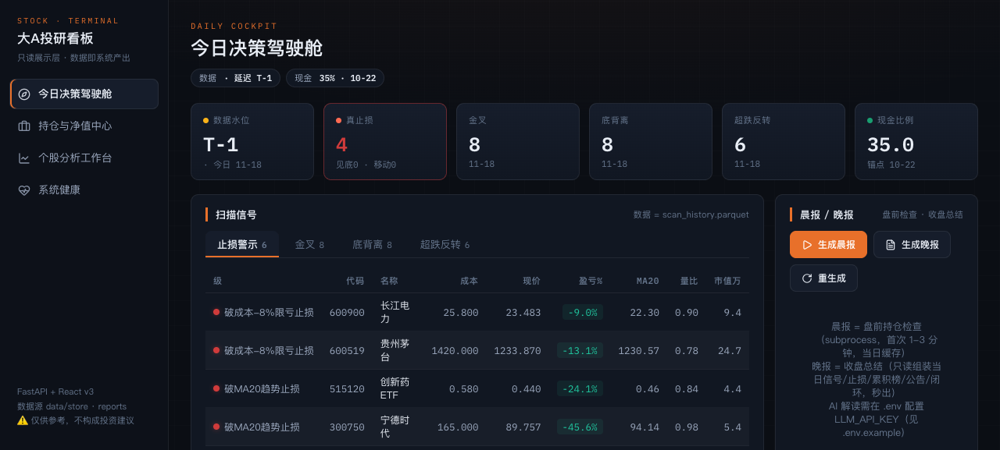
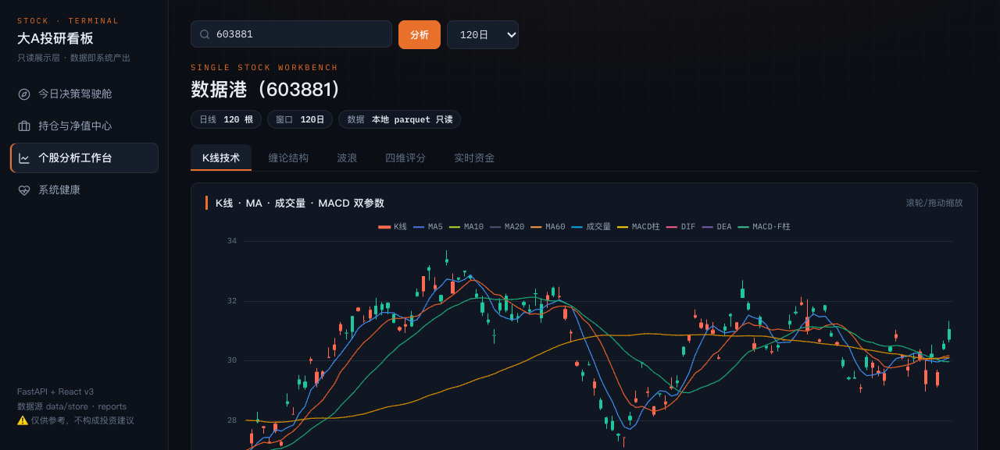

# astock-terminal · A 股投研终端

**本地优先的 A 股投研终端：数据自持 · 策略可改 · AI 可选。**
FastAPI + React + ECharts 四页看板（决策驾驶舱 / 持仓与净值 / 个股分析 / 系统健康），
配一套可运行的收盘扫描与信号体系。你的数据留在你自己的磁盘上。

> ⚠️ **免责声明**：本项目输出（含 AI 解读）均为程序计算与信息整理，**不构成任何投资建议**。
> 由此产生的任何交易决策与盈亏由使用者自行承担。详见 [DISCLAIMER.md](DISCLAIMER.md)。

| 驾驶舱 | 持仓与净值 |
|---|---|
|  |  |

| 个股分析（K线·双MACD·缠论·波浪） | 系统健康 |
|---|---|
|  |  |

## 30 秒体验（demo 模式，合成数据）

```bash
git clone https://github.com/<你>/astock-terminal && cd astock-terminal
pip install -r requirements.txt          # 核心依赖（约 1 分钟）
cd web/frontend && npm install && npm run build && cd ../..
make demo                                # 生成演示数据并启动 → http://localhost:8601
```

## 接入你自己的数据（三步）

```bash
make init                                # ① .env + 持仓模板向导（含 tushare 注册指引）
#    编辑 config/portfolio.xlsx 填入你的持仓、capital.xlsx 填资金
PYTHONPATH=. python scripts/data/update_all_kline.py    # ② 首次全市场日线（需 TUSHARE_TOKEN）
PYTHONPATH=. python scripts/screener/daily_scan_all.py  # ③ 首次收盘扫描（生成信号历史）
make serve                               # 启动 → http://localhost:8601
```

日常运转：crontab 挂 `update_all_kline`（16:10）与 `daily_scan_all`（16:15），
看板自动展示当日信号。详见 [docs/quickstart.md](docs/quickstart.md)。

## 数据源与模型

| 能力 | 需要什么 | 说明 |
|---|---|---|
| 看板四页 / demo | 无 | 纯本地 |
| K线+MA+MACD·波浪·净值 | 已有 parquet 或下载过一次 | 本地 |
| 日线下载 / 缠论 / 综合评分 | `TUSHARE_TOKEN`（免费注册） | [tushare.pro](https://tushare.pro)，积分制，详见 [docs/data-sources.md](docs/data-sources.md) |
| 缠论 60min / 部分实时 | `akshare`（`pip install -r requirements-full.txt`） | 免费接口，稳定性一般 |
| AI 解盘 | `LLM_API_KEY` + `LLM_BASE_URL` + `LLM_MODEL` | OpenAI 兼容协议：GLM / OpenAI / DeepSeek / 本地 Ollama 均可，见 `.env.example` |

## 架构

```
web/backend   FastAPI：4 个页面级聚合端点 + AI 解盘 + 晨报/晚报（纯只读）
web/frontend  React 18 + Vite + ECharts：交易终端风格（等宽数字 / CVD 校验色板 / dataZoom K线）
scripts/      数据层(core) · 分析层(analyzers) · 筛选层(screener) · 回测(backtest) · 130+ 研究脚本
templates/    持仓/资金配置模板     demo/  合成演示数据     deploy/  Docker
```

红线约定：看板对数据**只读**（不触发扫描、不写交易数据）；扫描与数据更新由
`scripts/` 下独立命令承担，crontab 调度。

## 许可与商业授权

- 开源协议：**GNU AGPL-3.0**（[LICENSE](LICENSE)）。云服务若使用本项目须开放源码，
  或购买商业授权。
- 商业授权 / 托管版咨询：`<你的邮箱>`
- English summary: A self-hosted A-share research terminal (FastAPI + React + ECharts) with
  daily scanners, dual-parameter MACD workbench, and optional AI digest via any
  OpenAI-compatible API. Licensed under AGPL-3.0; commercial licensing available.
